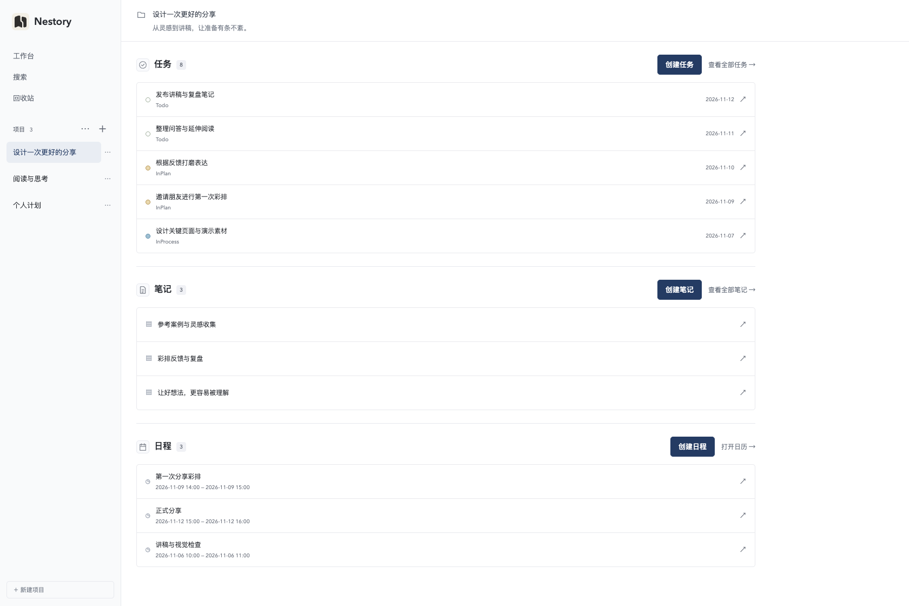
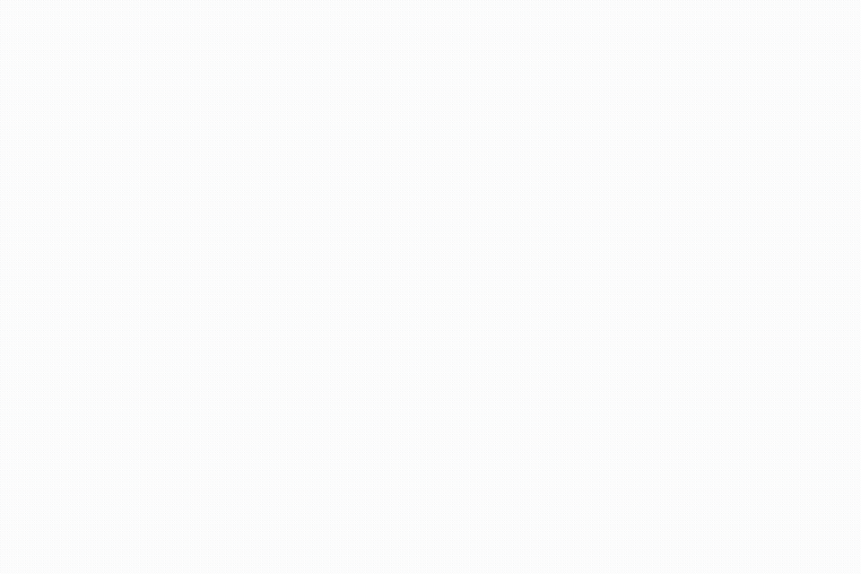
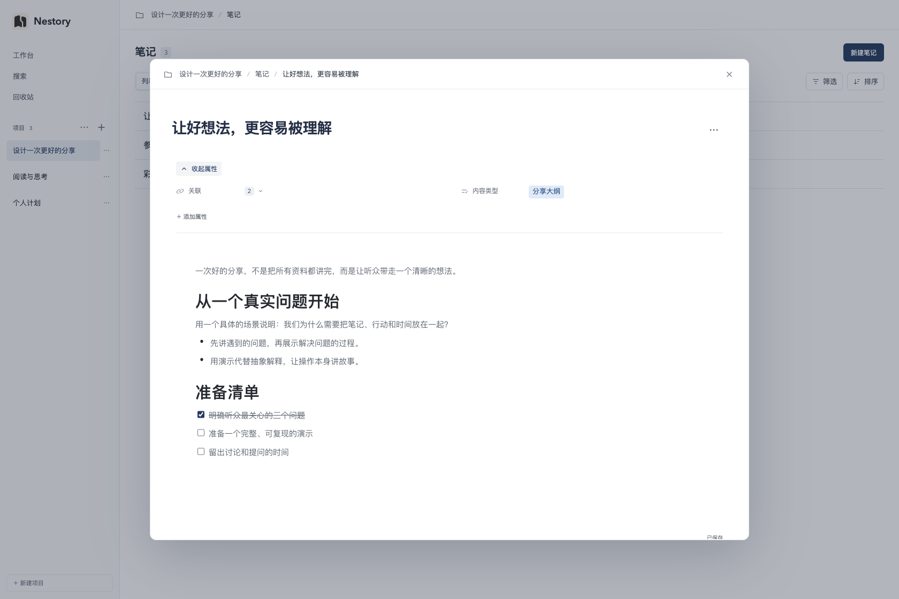
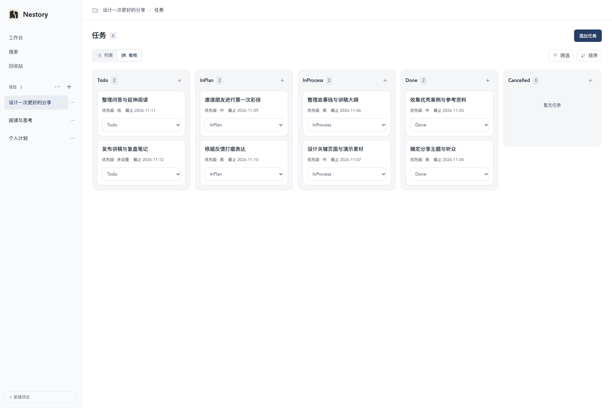
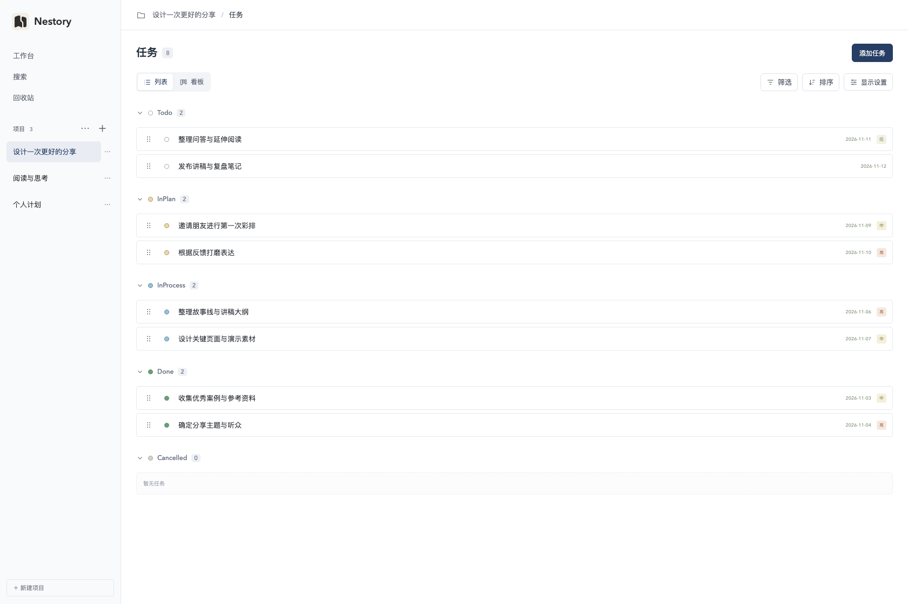
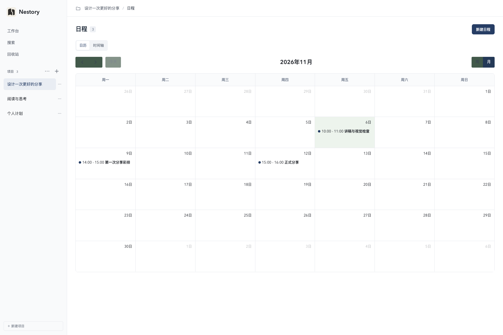

<strong>English</strong> | <a href="README.zh-CN.md">简体中文</a>

  

<h1 align="center">Nestory</h1>

  
  
  
  

<strong>Bring ideas, action, and time together.</strong>

Personal projects · Block notes · Task boards · Calendar

  <a href="#preview">Preview</a> ·
  <a href="docs/operations.en.md">Deployment</a>

---

Nestory is a self-hosted workspace for personal projects. Keep notes, tasks, and events together, so your ideas have a next step and your schedule has context.

See plans across projects on the dashboard, then open a project to focus. No account required. Your data stays on the device where you deploy Nestory.

## Preview

[Watch the full demo · MP4](docs/assets/product-tour.mp4)

## One project, three ways to work

### Capture ideas

Use block notes to collect references, record discussions, and develop ideas. Type `/` to insert headings, checklists, tables, code, images, or files. Drag blocks to rearrange your content, or import and export Markdown.

### Move work forward

Switch between lists and boards. Organize tasks by stage, priority, and due date, and break larger tasks into one level of subtasks. Filters, sorting, and collapsible groups help you focus on what matters now.

### Make time

Plan events in a weekly or monthly calendar, or use the timeline to see their duration. Drag events to reschedule, or select a time on the dashboard and create an event for its project.

See the task list and calendar

## Keep everything connected

- **Bidirectional links** — Connect notes, tasks, and events within a project and follow the relationship from either side.
- **Custom properties** — Add text, URLs, single-select, or multi-select fields. Definitions are shared across the same object type in a project; each item has its own values.
- **Consistent editing** — Open details in a centered dialog, collapse properties, and edit content with automatic saving.
- **Dashboard and search** — See open tasks and events across projects, and search titles and content.
- **Archive and restore** — Archive finished projects and restore accidentally deleted content from the trash by deletion batch.

## For example: prepare a talk

Create a project for your talk. Collect references in a note, add tasks for the first draft and demo, and schedule a rehearsal. Link them together to open your outline from the rehearsal or return to reference material from a task.

Your material, progress, and schedule each have a place—and remain connected.

## Self-hosting

Deploy Nestory with Docker Compose and keep your notes, tasks, and events on your own device.

[Read the deployment guide →](docs/operations.en.md)

Nestory is built for personal use on a local device or trusted local network.

## Acknowledgments

Nestory uses these open-source projects:

- [BlockNote](https://www.blocknotejs.org/) — Block editor.
- [FullCalendar](https://fullcalendar.io/) — Calendar components.

## License

Licensed under the [MIT License](LICENSE).
