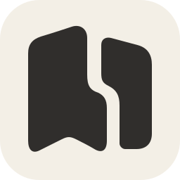

<p align="center">
  
</p>

<h1 align="center">Nestory</h1>
<p align="center">把任务、笔记和日程，放回项目里。</p>

Nestory 是面向个人的项目工作空间。用笔记记录想法，用任务推进工作，用日程安排时间；三类对象可以相互关联，工作台汇总跨项目的待办与日历。

采用 Go、React 和 SQLite，一个 Docker 容器同时提供界面与 API。适合本机或受信任局域网免登录使用，数据库与附件保存在同一个持久化数据卷中。

## 功能

| 功能 | 使用方式 |
| --- | --- |
| 项目 | 汇总任务、笔记和日程，支持置顶、重命名、归档与删除。 |
| 任务 | 五个固定阶段、一层子任务、优先级和截止日期；列表与看板共享筛选、排序和阶段拖动。父子任务状态独立。 |
| 笔记 | 扁平列表，支持标题、创建/更新时间和自定义属性筛选。 |
| 日程 | 周/月日历与时间轴，支持有效起止时间、日历拖动改期。工作台可直接点击日期或选择时段创建。 |
| 块编辑 | 输入 `/` 插入标题、列表、待办、代码、引用、表格、图片或文件；支持块拖动和 Markdown 导入/导出。 |
| 属性与关联 | 统一属性栏，支持文本、网址、单选、多选；任务、笔记和日程之间可建立同项目双向关联。 |
| 保存与恢复 | 自动保存、失败保稿、冲突提示；项目归档后只读，删除内容按批次恢复。 |
| 工作台与搜索 | 跨项目日历和未完成任务列表，搜索标题及块正文。 |

对象详情在居中浮层中打开。视图、筛选、排序和折叠偏好按项目保存在当前浏览器；换设备不会同步。

## Docker 快速启动

需要 Docker Engine 与 Compose v2。在仓库根目录执行：

```sh
cp .env.example .env
APP_VERSION=$(git rev-parse HEAD) docker compose up -d --build
scripts/smoke.sh --url http://127.0.0.1:8080
```

打开 [http://127.0.0.1:8080](http://127.0.0.1:8080)。首次构建需要下载基础镜像与依赖。

默认数据卷为 `noteapp_noteapp-data`，保存 `/data` 下的 SQLite 和附件。产品名称为 Nestory，工程命令、服务、Go 模块和数据卷继续沿用 `noteapp`，升级时保持原卷名。

```sh
# 停止应用，保留数据卷
docker compose down

# 查看运行日志
docker compose logs --tail=100 noteapp
```

`docker compose down -v` 会删除数据卷，不用于正常停止或升级。

## 开始使用

1. 创建项目，从项目汇总页添加任务、笔记或日程。
2. 打开对象，直接编辑标题和块正文；停止输入约 800ms 后自动保存，留意保存状态。
3. 展开属性栏设置任务阶段、优先级、截止日期或日程起止时间；通过关联连接同项目内容。
4. 在任务页切换列表/看板，用筛选器和排序器整理内容；点击阶段标题折叠分组。
5. 在工作台点击日历日期或选择时段，选择所属项目并填写标题，自动创建日程。

新建自定义属性时先选择类型，再命名、填写值。同项目同类型对象自动获得该属性定义，各对象的值独立。跨类型复用会复制定义、选项与颜色，之后独立管理。属性设置管理属性，选项行的三点菜单管理选项名称、颜色和删除。

保存失败或版本冲突时，先处理页面提示。未保存草稿属于当前浏览器，清理站点数据不会保留这些草稿；完整数据保护依靠数据库与附件备份。

## 配置

Compose 配置写入 `.env`；直接运行 Go 时通过环境变量传入。Go 进程不会自动加载 `.env`。

| 变量 | 默认值 | 说明 |
| --- | --- | --- |
| `APP_BIND` | `127.0.0.1` | Compose 主机绑定地址。 |
| `APP_PORT` | `8080` | Compose 主机端口。 |
| `APP_IMAGE` | `noteapp:local` | 构建与启动的镜像名称。 |
| `APP_VERSION` | `development` | 镜像源码版本标识。 |
| `APP_VOLUME_NAME` | `noteapp_noteapp-data` | 持久化卷；修改会切换数据集。 |
| `APP_TIMEZONE` | `Asia/Shanghai` | 日历、日期筛选及今日/本周的统一时区。 |
| `APP_ALLOWED_HOSTS` | `localhost,127.0.0.1,::1` | 允许访问的精确主机名/IP，不含端口。 |
| `APP_UPLOAD_LIMIT` | `20971520` | 单附件上限，默认 20 MiB。 |
| `APP_ADDR` | `127.0.0.1:8080` | 直接运行 Go 的监听地址；容器使用 `:8080`。 |
| `APP_DATA_DIR` | `./data` | 直接运行 Go 的数据库与附件目录；容器使用 `/data`。 |
| `APP_DEV_ORIGIN` | 空 | 额外允许的开发浏览器来源。 |

局域网访问需同时设置 `APP_BIND=0.0.0.0`，并把实际主机名/IP 加入 `APP_ALLOWED_HOSTS`。应用没有登录和团队权限，仅适用于受信任网络；Host 白名单不能替代身份验证。当前不直接信任 `X-Forwarded-*`。

## 本地开发

仓库锁定工具链：Go **1.27.3**、Node **26.9.0**、npm **11.19.1**。依赖由 `go.mod`、`go.sum` 和 `web/package-lock.json` 锁定。

先构建前端，再启动内嵌静态文件的 Go 服务：

```sh
npm ci --prefix web
npm run build --prefix web
go run ./cmd/noteapp
```

热更新开发使用两个终端：

```sh
# 终端一：后端
APP_DEV_ORIGIN=http://127.0.0.1:5173 go run ./cmd/noteapp
```

```sh
# 终端二：前端，/api 代理至本机 8080
npm run dev --prefix web
```

打开 [http://127.0.0.1:5173](http://127.0.0.1:5173)。

## 测试

```sh
go test ./...
go test -race ./...
go vet ./...
npm run typecheck --prefix web
npm run test --prefix web -- --run
npm run build --prefix web
```

浏览器测试会创建、修改测试数据。推荐使用脚本启动的独立临时容器与数据卷：

```sh
npm exec --prefix web -- playwright install chromium
docker build -t noteapp:test .
sh scripts/audit/run_browser.sh noteapp:test
NOTEAPP_TEST_IMAGE=noteapp:test python3 -m unittest discover -s scripts/tests -p 'test_*.py'
```

也可通过 `PLAYWRIGHT_CHROMIUM_EXECUTABLE_PATH` 指定已有 Chromium。运维脚本要求 Python 3.9+，包含标准库 `sqlite3`。

## 备份、升级与恢复

备份脚本会暂时停止指定容器、备份整个数据卷，并尝试恢复原运行状态。清单包含镜像版本、数据库检查结果和附件 SHA；不要在运行中只复制数据库主文件。

以下容器名适用于 Compose 项目名为 `noteapp` 的默认安装；其他安装应先用 `docker compose ps` 确认实际名称：

```sh
scripts/backup.sh --container noteapp-noteapp-1 \
  --volume noteapp_noteapp-data --image noteapp:local \
  --app-version "$(git rev-parse HEAD)" --output "$PWD/backups/before-upgrade"
```

备份完成后，使用新源码或镜像，沿用原来的 `.env` 和数据卷重建：

```sh
APP_VERSION=$(git rev-parse HEAD) docker compose up -d --build --force-recreate
scripts/smoke.sh --url http://127.0.0.1:8080
```

恢复使用预先创建的空卷和备份清单中记录的镜像 ID：

```sh
docker volume create noteapp-restored
scripts/restore.sh --volume noteapp-restored \
  --image <manifest.json中的image_id> --backup "$PWD/backups/before-upgrade"
```

恢复脚本拒绝覆盖非空卷。先启动恢复检查实例、核对正文和附件，再切换正式卷。旧镜像不能直接连接升级后的数据库；回退应恢复对应旧备份。

schema6 及更早版本的非空 Markdown 正文需要先离线准备块迁移，详见[运维手册](docs/operations.md)。新安装无需此步骤。

## 技术结构

Go 轻量模块化单体，普通构造函数组装依赖；React + TypeScript + Vite 前端，SQLite 保存业务数据，附件保存在同卷文件目录。一个非 root Docker 容器提供前端与 `/api/v1`。

```text
cmd/noteapp/          服务入口
internal/            业务模块、事务、HTTP适配与数据库
migrations/          SQLite迁移
web/src/             React界面与块编辑器
scripts/             备份、恢复、检查和性能探针
docs/                当前说明、架构、运维与历史验收证据
```

正文唯一存储格式为版本化块 JSON。HTTP 更新使用版本检查，跨对象关系与删除恢复有事务约束；创建请求支持幂等重试。编辑器按需加载，GET JSON 支持协商 gzip。完整技术说明见[架构文档](docs/architecture.md)与[自定义属性 API](docs/custom-properties-api.md)。

## 当前边界

- 面向个人规模；完整列表仍读取正文，没有分页或无限规模保证。单项目每类 1000 个对象的[性能测量](docs/evidence/docs-performance-20261029/README.md)是测试样本。
- 筛选条件按 AND 组合，暂不支持 OR、嵌套条件或命名筛选。
- 日程时间轴支持跨度展示，暂不支持拖动改期、依赖连线或自动排程；日历支持拖动改期。
- 笔记界面为扁平列表，旧库层级数据保留；不提供子笔记创建和目录树操作。
- 正文上限为 2 MiB；每项目每类型最多 64 个自定义属性。Markdown 导出不保证保留所有原生块属性，完整备份请使用运维脚本。
- 当前不提供多人协作、登录、自定义阶段、重复日程和提醒。

## 常见问题

**升级后内容不见了？** 检查 `APP_VOLUME_NAME` 和 Compose 项目配置是否仍指向原数据卷。修改卷名会打开另一份数据，不要因此删除旧卷。

**局域网访问返回 403？** 检查访问主机名/IP 是否加入 `APP_ALLOWED_HOSTS`，并确认端口绑定允许局域网访问。

**页面仍显示旧名称或图标？** 刷新页面；浏览器可能单独缓存 favicon。先确认服务正在使用新构建，再尝试强制刷新。

**Go 编译提示工具版本不匹配？** 检查 `go env GOROOT` 和 `go tool compile -V`。若环境残留旧 `GOROOT`，可尝试 `env -u GOROOT go test ./...`。

**编辑器加载失败或保存失败？** 根据界面提示重新加载或重试；先保留、复制尚未保存的草稿。不要通过清理浏览器存储处理未确认的保存问题。

## 文档与验证记录

- [现行产品说明](docs/current-product.md)：当前功能、规则及历史设计的优先关系。
- [运维手册](docs/operations.md)：部署、升级、备份和恢复。
- [架构文档](docs/architecture.md)：模块、对象、属性与事务边界。
- [性能检查](docs/evidence/docs-performance-20261029/README.md)：测量方法、实际结果与限制。
- [最初第一版验收](docs/acceptance-v1.md)与[近期审计](docs/audits/2026-10-27-recent-changes.md)：各自对应日期和提交范围的证据。
- [品牌资源](design/nestory/final/README.md)与[依赖记录](docs/implementation/dependencies.md)。
